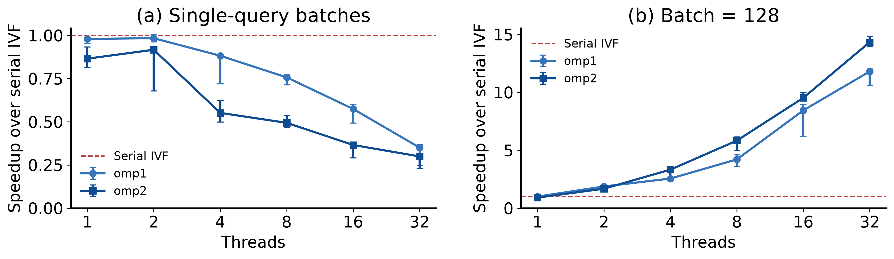

# OpenMP IVF-Flat 向量检索实验报告

刘师妤 · 2024201568　｜　实验日期：2026-11-05

## 1. 实现、环境与验证

本实验在完整 SIFT1M 上实现查询级 OpenMP（omp1）、查询内部候选任务（omp2）、候选距离 SIMD 和 std::thread 对照。批量查询中，32 线程 omp2 的标量版本达到 16,108 QPS，相对串行 IVF 加速 14.33 倍；batch=1 时两种策略均随线程增多而变慢。

**查询级并行。** omp1 每次 batch 建立一个团队，用 `omp for schedule(static)` 连续分配查询。每个查询独立选择中心、扫描候选并维护 Top-k，输出区互不重叠。std 按连续区间均分查询，每次调用创建、绑定并 join 工作线程，生命周期成本全部计入。

**候选任务。** omp2 每个 batch 只建立一个团队。每个查询对应一个父 task；父任务选列表，把各非空列表切成至多 grain 个候选的块，再生成子 task。子任务只写自己的局部 Top-k 切片。块描述、局部结果和异常数组由父任务持有，`taskgroup` 等待全部子任务结束，随后合并并释放；没有嵌套团队或逐候选 critical。

每块只保留 k 项足够：若某候选不在本块 Top-k 中，该块至少有 k 项按统一的 (distance,id) 全序排在它之前，因此它不可能进入全局 Top-k。块数 B 增多时，局部结果空间为 O(Bk)，任务调度为 O(B)，合并检查至多 Bk 项，堆维护约 O(Bk log k)。

**SIMD。** 先将坐标转为 double，再计算差值、乘积及归约，Top-k 在维度循环外更新。两个策略共用原标量中心选择；off 调用公共距离，on 使用 `omp simd reduction(+:sum)`。串行参考与 IO 文件保持原样。

| 环境或参数 | 本次设置 |
| --- | --- |
| 系统、编译与运行时 | Linux 5.15.0-60，GCC 11.4.0，libgomp.so.1 |
| CPU、内存 | Xeon Gold 5218 @ 2.30GHz；客户机可见 32 CPU；49 GiB 内存 |
| 资源边界 | VM 报告每可见核心一个线程；宿主物理核与 SMT 分配未知，以 P=32 客户机预算运行 |
| 编译 | -O3 -std=c++17 -fopenmp -pthread；无 fast-math、march=native |
| 数据与默认参数 | N=1,000,000，d=128，L=4096；Q=128，k=10，nprobe=8，grain=1024 |
| 绑定与等待 | taskset CPU 0–31；OMP_PLACES={0},…,{31}；PROC_BIND=close；WAIT_POLICY=PASSIVE；DYNAMIC=FALSE |

串行及主线程绑定 CPU 0，std 工作槽 t 绑定 CPU t，OpenMP 使用相同 places。独立统计的 10,294 个有效 CPU 端点均与指定位置一致；端点采样不代表完整迁移轨迹。A 的大 batch 固定为 4P=128。

**正确性与计时。** 公共测试、2,905 个学生实现配置、48 个统计配置及 CLI 测试通过。服务器正式 40 配置 ×10 次重复全部逐项检查通过；另有 40 次独立诊断，候选、任务和完成查询总数相符。五个数据哈希和 13 个实验源码哈希匹配本机。此前真实数据 pilot 的 24 组检查包含全列表与独立全库参考比较。ID 完全一致，距离 atol=rtol=1e-10；固定 nprobe 的 Recall 一致。

每配置先预热一次。T 是全部同步 batch 检索调用的墙钟时间之和，包含中心选择、分块、分配、距离、Top-k、合并及同步；加载、参考生成、检查、CSV 和预热在外。统计另跑，不并入正式计时。使用 QPS=Q/T、S=Tserial/Tparallel、E=S/p；完整最小/中位/最大值见附录 all_metrics.md。

<!-- pagebreak -->

## 2. A：扩展性、延迟与线程对照

下表均为公共标量距离。时间是全部 128 个查询的十次重复中位数，单位 ms；加速比分别使用同 batch 的串行 IVF：batch=1 为 113.690 ms，batch=128 为 113.895 ms。

| p | b=1 omp1 T | b=1 omp2 T | b=128 omp1 T | omp1 S / E | b=128 omp2 T | omp2 S / E |
| --- | --- | --- | --- | --- | --- | --- |
| 1 | 116.067 | 131.452 | 114.062 | 1.00 / 99.9% | 125.224 | 0.91 / 91.0% |
| 2 | 115.640 | 124.045 | 60.874 | 1.87 / 93.5% | 67.951 | 1.68 / 83.8% |
| 4 | 128.920 | 206.308 | 44.617 | 2.55 / 63.8% | 34.267 | 3.32 / 83.1% |
| 8 | 150.250 | 230.304 | 27.077 | 4.21 / 52.6% | 19.541 | 5.83 / 72.9% |
| 16 | 198.063 | 311.057 | 13.494 | 8.44 / 52.8% | 11.961 | 9.52 / 59.5% |
| 32 | 324.547 | 380.034 | 9.653 | 11.80 / 36.9% | 7.946 | 14.33 / 44.8% |

**批量查询有效分摊同步成本。** batch=128 时，两种策略均随线程数增加而加速。p=32 时 omp1 的最小/中位/最大为 9.492/9.653/10.740 ms，omp2 为 7.682/7.946/8.160 ms，分别达到 13,261 和 16,108 QPS。候选任务允许同一查询的多个块并行，提供了不同于静态查询分配的工作粒度；本次 omp2 比 omp1 快 1.21 倍。效率低于线性扩展，与串行中心选择、同步、任务管理及虚拟机资源共享等因素有关，各因素比例尚未单独测定。

**单查询调用产生负优化。** batch=1、p=32 时 omp1 实际仅一个候选线程工作；omp2 最多九个，平均每查询仅 1030/128=8.05 个子任务。中心选择仍由父任务串行完成，每个短 batch 都要同步团队，PASSIVE 等待下还存在唤醒成本。两者总时间均超过串行。线程数和 batch 的对照支持“查询太少时不能靠增加线程改善延迟”；各项同步开销尚未单独分解。

| batch=1，p=32 | serial | omp1 | omp2 |
| --- | --- | --- | --- |
| 查询延迟 p50 / p95（ms） | 0.854 / 1.154 | 2.418 / 3.389 | 2.956 / 3.382 |

分位数来自十次重复的 1,280 个逐查询样本，按 (n−1)p 线性插值。batch=128 时记录的是批完成时间：omp1 p50/p95=9.653/10.461 ms，omp2=7.946/8.136 ms，不将其除以 128 当作响应延迟。

**std 对照。** 相同 CPU 集合、绑定、距离及 batch 下，std 的最小/中位/最大为 10.470/10.875/12.158 ms，相对串行加速 10.47 倍；omp1 中位时间少 11.2%。std 每次创建、绑定、回收 32 线程，OpenMP 可复用线程池；差值也包含运行时调度等因素，不能全部计为线程创建成本。规则循环用 OpenMP 更方便；需要自管长期线程生命周期、队列或线程通信时，std 提供直接控制。

<!-- pagebreak -->

## 3. B：查询分布与 C：任务粒度

**B：排序使静态分配的候选工作更不均。** 4,096 个列表长度中位数为 227、最大 1,257；同一查询池 C(q) 中位数 2,122、最大 5,395、总数 296,624。仅同步排列查询与 ground truth，p=32、batch=128、距离与 grain 固定；候选集合与 Recall 保持一致。

| 策略与顺序 | T 中位数（ms） | max(Wt)/mean(Wt) |
| --- | --- | --- |
| omp1 原始 / 升序 / 降序 | 9.653 / 11.493 / 10.125 | 1.392 / 2.223 / 2.223 |
| omp2 原始 / 升序 / 降序 | 7.946 / 8.084 / 8.038 | 1.524 / 1.461 / 1.839 |

omp1 的 static 连续分配每线程四个查询。排序把工作量相近的查询聚到一起，使最忙线程的候选数相对均值上升；升序耗时增加 19.1%，降序增加 4.9%。升降序的候选失衡值相同而时间不同，说明 Wt 只描述候选量，中心选择、调度及数据访问也影响时间。数据局部性的贡献没有硬件计数证据，不能单独归因。

omp2 可在同一团队调度各查询与候选任务，三种顺序中位时间相差不超过 1.8%，但独立统计的工作分配随调度变化；一次诊断不能说明每轮的负载分布都相同。所有 Wt 之和均等于 296,624，包含零候选线程。排序消融保留了同一查询池，支持静态分配对工作量顺序敏感的结论。

**C：过细任务增加管理成本；4096 的异常需要复测。** 以下固定 omp2、p=32、batch=128、nprobe=8。每次还有 128 个查询父任务。

| grain | 子任务数 | 时间 min / med / max（ms） | 单查询已知数组最大字节 | 合并区间之和（ms） |
| --- | --- | --- | --- | --- |
| 64 | 5,147 | 9.724 / 10.377 / 10.664 | 16,832 | 0.980 |
| 256 | 1,607 | 7.734 / 7.793 / 8.293 | 4,880 | 0.567 |
| 1024 | 1,030 | 7.682 / 7.946 / 8.160 | 1,768 | 0.445 |
| 4096 | 1,024 | 11.364 / 37.877 / 75.667 | 1,472 | 0.455 |

grain 从 1024 减为 64，子任务数约增五倍，单查询已知数组上界明显增加，合并区间之和约增至 2.20 倍，正式中位时间增加 30.6%。它们共同支持细粒度增加任务和局部结果管理成本的解释，但不能把统计时间差直接分解为正式运行的调度成本。

grain=256 中位时间比 1024 少 1.9%，十次范围重叠，本轮不足以确立稳定优胜者，保留 1024 作为统一对照。grain=4096 的子任务数只比 1024 少六个，因为大多数列表本就短于 1024；37.877 ms 的异常中位数不能只用“任务少、负载不均”解释。原始十次值完整保留，应交替复测两配置后再判断，当前不据此修改算法。

单查询已知数组只计局部结果、块描述及异常数组，未包含运行时 task 对象、中心选择数组、分配器及其他查询的同时活动内存；子任务 Top-k 堆另有上界字段。因此该列不代表 batch 或进程峰值。阶段统计为每查询墙钟区间，查询之间可重叠；表中合并区间之和不等于整批合并耗时，不能除以正式 T 当作阶段占比。

<!-- pagebreak -->

## 4. D/E、性能工具与结论

**D：增大搜索范围提高 Recall，降低 QPS。** omp2、p=32、batch=128、grain=1024 和标量距离固定。三个 nprobe 的每次输出均与对应串行 IVF 完全一致。

| nprobe | 总候选数 | T 中位数（ms） | Recall@10 | QPS |
| --- | --- | --- | --- | --- |
| 1 | 38,231 | 6.028 | 29.77% | 21,234 |
| 8 | 296,624 | 7.946 | 72.66% | 16,108 |
| 32 | 1,161,959 | 16.153 | 94.22% | 7,924 |

nprobe 改变了候选集合，其收益应解释为召回与吞吐的取舍，不能混入并行加速比。中心选择仍需扫描 4,096 个中心，因此候选数缩小到约八分之一时，整次耗时也不会按同一比例缩短。

**E：SIMD 的额外收益约为 1.17–1.24 倍。** 相同策略、线程数和 batch=128 下分别比较 off/on，Recall 保持 72.66%。

| 策略 | p=1 off / on（ms） | 时间比 | p=32 off / on（ms） | 时间比 |
| --- | --- | --- | --- | --- |
| omp1 | 114.062 / 91.870 | 1.24 | 9.653 / 8.130 | 1.19 |
| omp2 | 125.224 / 101.706 | 1.23 | 7.946 / 6.797 | 1.17 |

GCC 的 `vectorization.txt` 明确记录 ivf_student.cpp:18 距离循环使用 16-byte vectors。公共距离循环没有对应的成功向量化条目；ivf_search.cpp:51 的向量化条目属于中心编号复制循环，不能当作距离向量化证据。只据报告确认 SIMD 路径，未用反汇编排除公共距离所有可能的向量指令。中心选择、堆和任务管理没有随候选 SIMD 开关一起优化，整次检索加速小于候选内核可能的加速。

**性能工具。** 实际 perf 在执行工作负载前报 `perf not found for kernel 5.15.0-60`；系统还记录 perf_event_paranoid=4。没有获得硬件计数或真实 perf FIFO 运行证据。按作业允许的回退，三策略均用 `/usr/bin/time -v` 完成；下表全部覆盖加载、参考、预热、十次检索、检查及进程生命周期。

| 整个进程指标 | serial | omp2（32） | std（32） |
| --- | --- | --- | --- |
| 墙钟 / 用户 / 系统时间（s） | 2.38 / 1.78 / 0.59 | 1.27 / 2.96 / 0.77 | 1.31 / 3.34 / 0.69 |
| 自愿 / 非自愿上下文切换 | 1 / 26 | 3068 / 31 | 199 / 381 |
| 最大 RSS（KiB） | 1,013,864 | 1,013,816 | 1,013,888 |

并行进程墙钟缩短而用户 CPU 时间增加，体现多线程消耗更多累计 CPU 时间。omp2 较多自愿切换与 PASSIVE 等待及同步相容；std 非自愿切换更多，但单次整进程记录不足以归因到某种检索操作。RSS 均约 990 MiB，主要反映完整数据和索引加载，不能用其微小差值测任务缓冲区。以上指标不换算为纯检索每查询计数，也不填造 cycles、cache-misses 或带宽结论。

**结论与范围。** 本次 VM 中，大 batch 的候选任务策略有较好的扩展性，单查询调用则应避免盲目增加线程。候选排序揭示静态查询分配的失衡，细粒度任务增加管理成本，SIMD 提供额外收益。负优化与高波动配置均保留。宿主物理核心分配、跨轮稳定性及真实 perf 计数仍待确认；未来可验证自适应粒度和小 batch 路径，当前数据不支持将这些优化写成已完成。

**AI 使用声明。** 使用 OpenAI Codex 辅助实现、测试、实验脚本、结果核对及本报告草稿；Linux 实验由学生在课程服务器执行。学生应逐项核实代码、数据和结论，技术问答截图随提交附上。个人心路历程由学生另行撰写。

**参考。** [Faiss 索引](https://github.com/facebookresearch/faiss/wiki/Faiss-indexes)；[OpenMP 5.2：taskgroup / SIMD](https://www.openmp.org/spec-html/5.2/openmp.html)；[perf stat](https://man7.org/linux/man-pages/man1/perf-stat.1.html)；[GNU time](https://www.gnu.org/software/time/)。
